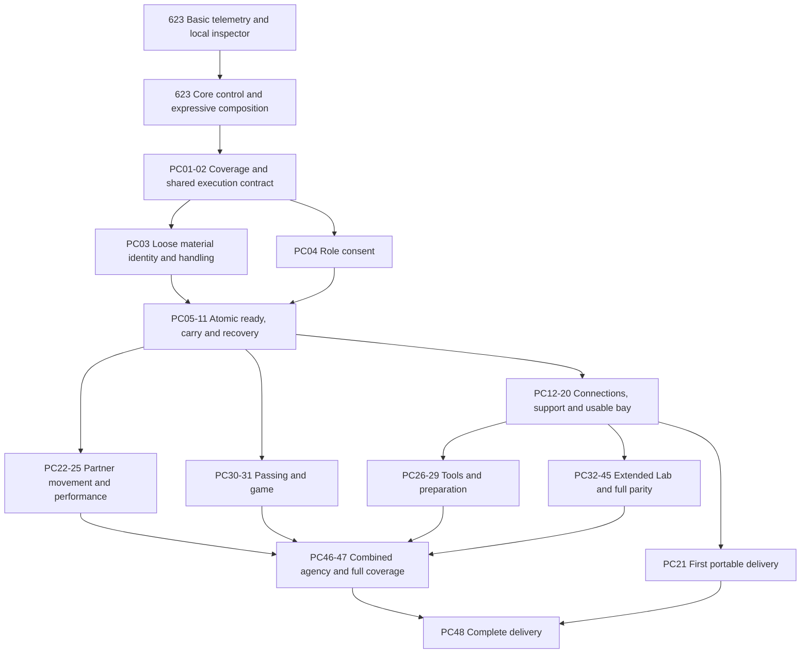

# Voluntary physical coordination and reusable construction

**Design intent and planning baseline, not implemented API documentation.**
The outcome is tracked in [#560](https://github.com/soulsimulation/souls/issues/560), a workstream of the
[controllability umbrella #623](https://github.com/soulsimulation/souls/issues/623) and its
[agency-quality design](agency-quality.md). Mars College 2027 is the first
application; the mechanics, material packs and procedures must work in other compatible worlds.
This plan extends Soul Actions after accepted entries 1–44. It authorizes no implementation or deployment.

Souls independently agree to a bounded activity, then the world executes its continuous physical motion.
A manager can organize work but cannot commandeer another owner's Soul. The first two-person carry and first
six-volunteer rack bay are useful milestones; neither completes this program.

## Scope and existing foundations

Required outcomes are the coordination lifecycle, authentic construction recovery, working examples across all
six activity families below, and the interactive materials/accessories those examples require. Prefer adapting
preserved native machinery over reconstructing it from generic pickup actions.

The November 1 research used release 4.09 (`5eebdc33`). Planning intake checked main `ecb63f57` and release 4.12
(`fa695018`). Twelve relevant source files were byte-identical to the research baseline, including the carry
bridge, together ledger, catalogue adapter, camp construction/disassembly, runtime snapshot, sequence schema,
campus generators, native catalogue, Lab registry and authored rack definitions. This is scoped source evidence,
not a new behavioral qualification. Subsequent work must check its actual base.

| Foundation | What can be reused | Gap or proof limit |
|---|---|---|
| Native carry, raise, connect, install and reverse primitives | Formation motion, support/claims, procedural contact and navigation changes | Independent owner consent and current shared-session recovery are not established by native playback |
| `mars-sequence/1`, campus assembly and generators | Parameterized actors/objects/points, dependencies and failure policies | Separate reusable procedures from fixed campus staging, specialized registries and centrally selected crews |
| Together invitations, handovers and social actions | Accept/decline/expiry, authenticated actors, paired actions | Existing membership does not represent material/socket claims or safe structural exit |
| Music clocks, dance and hand-holding | Shared phase, gestures, contact and current solo dance-in-place | Do not recreate shipped actions or infer all partner variants work |
| Camp construction/disassembly | Progress from real parts and reverse dependencies | Fixed camp identity and availability-based crew selection do not establish consent |
| Host persistence and native snapshots | Event replay, checkpoint deferral and supported action codecs | Carry and many construction lifts remain explicitly unverified for native mid-action snapshots; prove host replay or serialization per primitive |
| Generic entity catalogue | Authoring, immutable revisions, ordinary placement | Adapter can reduce a structural object to a fixture or one-hand item |

The current solo carry offer uses `move_fixture` and refuses a crew requirement above one. The library's
`core/pallet-rack@1` is a complete bay, `core/rack-beam@1` has two-grip metadata but enters the ordinary one-hand
item path, and `core/plywood-stack@1` has no counted sheet extraction. Their appearance is not a construction API.
Do not mutate old definitions to reinterpret existing worlds; introduce compatible versioned definitions/adapters.

## Agreement and execution contract

These are proposed semantics, not new endpoint names. Extend existing invitations, receipts and activity clocks.
The first concrete contract, for one shared ground carry, is [shared-execution.md](shared-execution.md) (PC02).
Keep conversation membership distinct from physical participation: discussing help is not accepting a grip,
and leaving a conversation does not drop a load.

1. **Propose:** identify versioned activity, world, materials/resources, roles, destination/work zone, anticipated
   duration, permitted variation and safe-stop policy. It is an offer, not permission to move anyone.
2. **Accept:** each authenticated participant accepts a role against the same revision, or declines. Acceptance
   can expire before execution. Material changes to destination, object, role or scope need renewed acceptance.
3. **Gather:** Souls independently approach through ordinary admitted movement and resolve incompatible possessions.
   Before coupling, a participant can leave freely.
4. **Ready:** verify actual stance, reach, hands, capability and location; moving away makes a participant unready.
5. **Commit:** atomically revalidate permissions, proposal/resource versions, support, whole-formation feasibility
   and every required claim. Acquire all required bodies/capabilities, objects and connectors or start nothing.
6. **Execute:** advance one authoritative operation on the world clock; every observer renders that state.
7. **Stop safely:** withdrawal or failure requests the accepted cleanup; required physical claims remain while
   supporting the load. A safe interruption is not successful arrival.
8. **Release:** record actual conserved objects/effects and correlated per-member outcomes; release claims only
   when physically valid.

A session needs stable identity/revision, versioned template, accepted roles, readiness, resource identities and
versions, operation identity, phase/claims/timing, permitted recovery and ordered outcomes. Invitation retries
must not duplicate an operation. Keep proposal reservations bounded and fair; their expiry cannot release a load
already physically held. Contention for a body, material or connector must not half-start or deadlock.

Reserve only used capabilities: hands, locomotion, stance, equipment or connector. Minds may still think, speak
and observe. Incompatible commands explain the commitment and offer a safe stop; they do not freeze the mind or
silently discard unrelated owner instructions. Named states distinguish waiting, stopping, blocked, declined,
expired, interrupted and completed outcomes.

The initial default is consent to one bounded maneuver and its disclosed cleanup. Finite multi-maneuver advance
consent may be supported only with explicit scope, checkpoint and revision rules. It never means unlimited
project authority. A different crew or organizer can propose subsequent work at safe boundaries.

## Feasibility, interruption and recovery

Plan the whole crew and load: swept volume, turning clearance, vertical band, body reach, support and set-down
locations. Independent paths through a doorway do not prove a long beam can turn through it. Before lifting,
refuse an impossible configuration or state that bounded planning could not establish a route.

| Event | Required behavior |
|---|---|
| Brief obstruction | Wait while preserving support/grips, then continue when clear |
| Valid minor detour | Replan within accepted scope and route constraints |
| Lasting blockage | Allowed safe set-down or retreat; report interruption |
| Return route remains feasible | Returning to the start is an option, not universal undo |
| Materially different destination, maneuver or crew | Reach a safe checkpoint and seek renewed agreement |
| No safe movement or release | Explicit supported blocked state with assistance options; unrelated activity continues |

Use bounded planning/backoff and ordinary edit/admission rules to protect active support geometry. World edits
and simultaneous activities must not silently invalidate a carried load or occupied structure. No teleporting,
phasing, dropping loads or recruiting unconsenting replacements to manufacture success.

Withdrawal is requested immediately, but a body may continue only the already accepted safe cleanup. Lower a
frame, set down a load, transfer support to an independently consenting ready replacement, or finish a short
stable dance transition as appropriate. A target cleanup duration is not a guarantee of an exit from adversarial
geometry. Report unavailable recovery honestly; do not impose an arbitrary whole-building commitment.

Distinguish a disconnected mind from server failure. A disconnected body can complete its accepted safe segment,
never autonomously join later tasks. Reconnect exposes the same session and actual outcome. Server restart must
restore scope, claims, identity and phase through verified replay or serialization. Test every supported primitive
at meaningful phases, including interruption. Do not snapshot-drop held loads or duplicate cuts, connections,
scores or audio cues. Incompatible/corrupt-state operator recovery is explicit and separate from gameplay.

## Materials, blueprints, procedures, sessions and projects

| Concept | Owns |
|---|---|
| Material/equipment definition | Geometry/collision/scale, mass/handling, crew-specific grips, valid poses, connectors, support and contact points |
| Blueprint | Desired assembly graph, compatible parts, relative transforms, structural dependencies, resulting floors/stairs/spaces |
| Procedure template | Roles, prerequisites, primitives, dependencies/barriers, effects, completion predicates and recovery boundaries |
| Session | Actual consenting Souls and world-local materials bound to an operation |
| Persistent project | Desired result and remaining work derived from actual structure, resumable by another crew |

Extend native sequence and construction primitives where they fit. Parameterize world, cast, object IDs,
translation/yaw and supported dimensions. A new arrangement of supported parts is data; a genuinely new connector
or manipulation is an explicit primitive. Arbitrary meshes are not automatically constructible.

Maintain one authority for poses, reciprocal connections and support. Scene parenting alone cannot mean a beam
is supported by two uprights. Rendering and persistent entity adapters observe the same state; avoid overlaying
a duplicate static campus mesh on dynamic materials. Project progress cannot independently declare completion.

The first of these is built: `rack-bay@1`, `rack-bay-build@1` and persistent projects ([soul actions](../architecture/soul-actions.md)).

Floors and stairs become navigable at actual installation and lose that affordance on safe removal. Temporary
bracing/held support counts only while present; protect occupants during disassembly. Reverse dependencies recover
the same instances where reversible. Cutting declares outputs/offcuts; consumed fasteners/finishes have explicit
accounting. Quantities and provenance survive extraction, transport, installation, interruption and restart.

## Authentic Lab recovery

[#561](https://github.com/soulsimulation/souls/issues/561) must enumerate the final published selector, special
`scenarioByName` routes, imported families, native construction scenarios, later source and relevant branch reports.
Every manifest row needs identifier/source revision, behavior, required materials/primitives, current disposition,
migration work and acceptance fixture. Distinguish construction, support capability, reusable activity, showcase
and deliberate refusal probe. Preserve correct refusals rather than converting every probe into success.

| Required coverage | Historical evidence and remaining distinction |
|---|---|
| `build-bay` | Six builders; two 12-foot frames/four 9-foot beams; five joists/two sheets; stairs/ten treads. Research observed 43/43 steps with zero reported violations **at 8× playback**. Not real-speed/current-owner proof; stairs began pre-delivered |
| `hand-up` | Upper receivers and forklift sheet presentation; preserved recipe, not new qualification |
| `prone`, `prone-forks` | Below-edge reception then rising while retaining load; authored bounds matter |
| `raise-cancel` | Include hidden/special regression routing and controlled lowering before independent support |
| `year-build-2022` | Historical 201 steps / 24 structural parts; qualify actual generated work |
| `year-build-2022-house` | Historical 555 steps / 66 parts; research checked preflight only, not complete playback |
| Full phase A/B | East-house historical 1,552 steps / 66 skeleton parts / 145 selected phase-B parts; Chiba 1,460 / 66 / 133. Explicit omissions remain. Kitchen stair carry and west-house stair-rail gathering failed |
| Roof, stairs, walls/framing, solar and stock processing | Unsupported parts require explicit work or a reviewed scope decision; do not inherit a green result from an omitted part |
| `solar-paint`, stock visuals | Renderer showcase, not a solar installation journey |
| Navigation/obstruction | Walls/traps/narrow passages, incomplete stairs, deck-ground, inserted obstacles, trio/crowd stress |
| Living/room preparation | Relocation, meals/sleep/classroom/work breaks/reading/music/chess/design studio/prepared days: map to shipped actions or voluntary adaptations |
| Year walkabouts and 2027 concept | Preserve relevant geometry/traversal; retained concept is distinct from the live user-created world |

Historical candidates include crew-stair-carry `baf0ccc`, crew-stair-obstacles `c403d81`, carry-height-band
`e9b6bc8`, staged-support `4abb117`, support-transfer-articulation `5dfe067`, top-beam-access `d81d4d7` and
forklift-traffic-recovery `9531a3b`. Inspect source/reports, dependencies and current-rig compatibility selectively.
Staged-support includes reverted work; explain the revert before reuse. Wave2-consolidation `ec3aa6f` had failures
and is a discovery source, never a wholesale upgrade. Full refs and original reports remain in the private
research archive; the original source lineage is not assumed available in a clean public checkout. The inventory
issue must publish sanitized provenance/fixtures needed by future workers before assigning recovery work.

**The manifest (PC01, [#680](https://github.com/soulsimulation/souls/issues/680)).**
[`physical-coordination-manifest.json`](physical-coordination-manifest.json) is the finite inventory, pinned to
`main` `df69a3ca`. It has:

- one row for each of the 68 Lab selector ids;
- one row for the hidden `raise-cancel-proof` route;
- 15 rows for native primitives and generated builds;
- 4 rows for server surfaces;
- 14 rows for asset needs.

Each row names:

- its class: `runnable`, `refusal-probe` or `showcase`;
- its current source;
- its primitives and assets;
- its in-tree evidence;
- the PC issue that owns the remaining work.

Per-scenario Lab proof grades stay in `mars/viewer/deploy/scenario-coverage.json`.

The two historical failures are recorded in the tree with their exact causes. Their rows stay `unresolved`.
- **Kitchen** stops at `carry.path-occupied`.
- **West house** stops at `carry.gather-stuck`.

Both causes come from `FULL_RED` in `mars/viewer/engine/test/year-build-houses.test.ts`.

The candidate refs above are not objects in this repository, so the manifest lists each one as a missing-source
blocker, with the PCs it blocks. Check the manifest after a pnpm install:
`node tools/physical-manifest/check.mjs`. The check (with `node --test tools/physical-manifest/check.test.mjs`) fails
in either case:
- a selector id is missing or extra;
- a source path, catalog id or library def does not exist.
- the pinned source or a reachable research baseline is not a commit in this repository, or a ref listed as missing
  is in fact present (`git cat-file`, failing closed).

Add a row when you add a scenario.

## Interactive asset coverage

The dated native inventory counted 155 definitions and 16 bundles; it is a reuse starting point, not a completeness
certificate. Required pack coverage follows every parity row, including upright/beam variants, individual sheets,
joists/timber, counted stock/bundles, stairs/treads, wall/framing, solar mounts/panels, cutting/staging accessories
and handling equipment. An upright is the complete braced two-column frame. Provisional dimensions/masses need
validation; the modeled 19-foot frame requires at least three carriers under its current mass rule.

Each definition needs visible geometry with matching collision/scale, reachable contacts, handling/orientation,
permissions, persistence and discoverable behavior. A stack without extractable sheets fails stock supply.
Reuse procedural geometry where appropriate; do not require GLBs or rebuild a decorative catalogue.
Author through ordinary tools, preserve immutable revisions/conformance supplements, and verify fresh-client
asset delivery plus a saved-yard reload. Other activity families include their actual tools/workpieces and props.

## Six required activity families

All families must work through the common agreement/claims/observation contract. Controllers differ: coupled load
motion, shared timing, role/dependency execution or independent decisions under shared rules. Six bespoke scripts
with invitation buttons do not establish reuse. Each new faculty needs a materially different supported example
and a correctly refused unsupported case.

| Family | Representative and reuse | Execution issue / existing scope |
|---|---|---|
| Moving together | Beam, differently shaped table/load, supported larger crew | [#564](https://github.com/soulsimulation/souls/issues/564); shared-load portion of #434 |
| Partner movement | Partner dance, arm-in-arm or supported paired exercise | [#567](https://github.com/soulsimulation/souls/issues/567); #441 and existing dance/hand-holding |
| Performance | Small ensemble with real audio, then stage gesture/movement cues | [#568](https://github.com/soulsimulation/souls/issues/568); #431 |
| Shared tools | Two-person saw with real outputs, then supported crank/hoist role variation | [#569](https://github.com/soulsimulation/souls/issues/569); stock/repair foundations |
| Joint preparation | Canopy from pieces, then tent or shared-setting setup/clearance | [#570](https://github.com/soulsimulation/souls/issues/570); #383/#427/#434/#437 |
| Games | Real two-/three-player passing/catching and a bounded passing-and-scoring team game | [#571](https://github.com/soulsimulation/souls/issues/571); #440/#439/#425 |

Sports use authoritative object motion and independently chosen player actions, not a prerecorded match. Soccer,
moving tennis, full basketball and other sports remain later roadmap outcomes; a pass does not complete them.
Tug-of-war, relay handoffs, assisted climbing, acrobatics, processions, shared cooking and puzzles remain related
applications, not substitutes for the required six representatives. Existing clothing, food, music, repairs and
vocabulary families retain their unrelated scope.

## Observation, agency and proof

Use the umbrella's common passive trace, local inspector, receipt/timing semantics and bounded stress method.
Shared session/revision/role/claim/operation and per-member outcomes extend that record; they do not create a
second logger, controller or dashboard. Correlate only authorized world facts and independently consented local
records. Physical participation does not grant access to another owner's private prompts, trace or media.

The owner must remain able to send a revision during shared execution. Prompt intake and stop acknowledgment,
model response, physical cleanup and resource release are distinct. Keep compatible speech/observation available;
report the actual resource preventing another action. After release/reconnect, reconcile each owner's latest
intention without resuming cancelled work. Persistent assembly progress never implies indefinite crew authority.

An agent discovers and joins a shared operation through the same strict offers as any other action. `act` takes
offered ids only ([CTRL-1, #1093](https://github.com/soulsimulation/souls/issues/1093)); `resolve "<words>"` returns
candidate ids and never acts. `inspect <id>` ([#1094](https://github.com/soulsimulation/souls/issues/1094)) is the discovery
path for an operation: its template, revision, load, destination, roles with holders and readiness, phase, and this
Soul's own offers with their parameter schemas. No session, role or next step has to be read from prose, and a Soul Run
cast sends offered ids too.

Roles must match a body's declared physical capabilities. The [custom body design](custom-bodies.md) extends
this to non-humanoids: a rigid body can participate through a validated adaptation, not an assumed humanoid grip.
Unsupported roles refuse before claims/lifting; an unsafe body change cannot escape an existing commitment.

Nearby relevant tasks, one's own invitations/commitments, missing roles/materials, actual custody, safe-stop
options and reasons for waiting must be discoverable. Deeper project/geometry detail is on request; normal Soul
context never includes every distant blueprint/grip/project. Wake at decisions/failures/checkpoints, not each tick.
Visitors should understand who is involved and what is waiting, with restrained cues rather than status text
masking missing physical contact. Compose locomotion/facing/gaze/idle/arm ownership and test current body/outfit
variants through approach, contact, held movement, release and return to normal activity.

Qualification covers independent authentication; consent/revision/expiry; atomic contention/idempotency; whole-load
geometry; interruption at each phase; mind disconnect and server restart separately; conserved materials and
exact effects; real structural support/navigation; alternate worlds/casts/blueprints; all parity rows and families;
current-rig visual/audio proof; ordinary tool usability; context/events/tick/render/assets externalities; and
fresh-client production usability. Existing Soul Actions long-tail criteria remain: absent/irrelevant context adds
nothing, including 100 objects 100 m away. Set other budgets from comparable current baselines, not arbitrary numbers.

Deterministic fake minds and separately authenticated scripted clients prove state/ownership boundaries. They do
not prove autonomous negotiation: include a bounded ordinary-agent discovery/agreement journey under current
model-use/budget authority. Evidence is uncut real-speed video where required, actual audio for sound, exact
source/environment and retained failed attempts. No new suite/gate merely to relabel historical evidence.

## Delivery order and work boundaries

The [umbrella](https://github.com/soulsimulation/souls/issues/623) owns phase priority, shared contracts and the
coordinator handoff; the [physical epic](https://github.com/soulsimulation/souls/issues/560) holds PC01–PC48 and their
scope parents. The following graph replaces the earlier coarse graph that appeared to require all structural
and navigation work before a ground carry. It expresses capability dependencies, not a parallel worker plan.

The diagram groups work for readability; each PC issue names its narrower hard dependencies. Ground carry needs
loose material handling, not a complete building graph or navigation bridge. Tool/preparation dependencies also
vary by family. None requires completion of the whole #383/#385 backlog. **Carry and recovery qualify before live
multi-owner use**. #384 owns construction primitive adaptation; #566/#572/#573 are linked outcomes, not a second
competing construction lane. General engine relocation #382 is not a prerequisite for proving a behavior in place;
retirement #387 must preserve required capabilities and evidence first.

The combined default order is basic telemetry, the local inspector, core control and expressive composition,
then physical inventory/contract, safe carry, first bay, other families, extended Lab and final qualification.
One coordinator and one serial implementation worker serve the combined agenda; ordinary component proof and
review happen throughout. Shared persistence/claim/controller paths have one writer at a time.
Use separate issue workspaces/data/ports and early PRs. Do not start a parallel implementation over active
performance #556 renderer/audio work; adopt its final source or coordinate the exact surfaces at a checkpoint.

Reuse accepted carrying/placement 3/4/29, handover 41, containers 42, music 14/26/36, social/game 7/27/35 and food 43/44.
Keep unresolved #417–#424/#494 findings visible: outfit seams, plant revival, social/game facing, self-intersection,
mirrored hands, piano contact, idle/active-arm conflict and lagging custody observations. Only a demonstrated
relevant defect blocks its dependent slice; this program does not silently close those issues or require all
unrelated fixes first. #426 owns wishlist reconciliation; packet, journal and vocabulary numbering stay distinct.

The handoff chooses independent agency and real physical object motion as direction. #425 retains detailed game,
ride/media and vocabulary decisions; inclusion here is not a blanket vocabulary unlock or implementation approval.
The first combined assignment is #732, not PC01. PC01/PC02 begin the later physical workstream; its first
implementation target is the smallest safe two-owner carry, including an agreed asset subset and recovery proof.
The first carry also proves ordinary input/conversation, owner revision/cancel, limited claim contention and
preserved independent intent after release; PC46 adds cumulative coverage rather than postponing these checks.
Estimates in #623 separate shared foundations from physical adaptation/assets/qualification and are reforecast
after source inventory and early behavior proof. Full scope is complete only with every required outcome evidenced or a
maintainer-approved scope change recorded explicitly.

Delivery uses normal import/pair/invite/build interfaces and the existing release owner, gate limits and live
checks. Inspect the target world's actual inventory before any import; the old 36-entity observation is not current
inventory or permission to overwrite content. No production changes follow from this design document.
